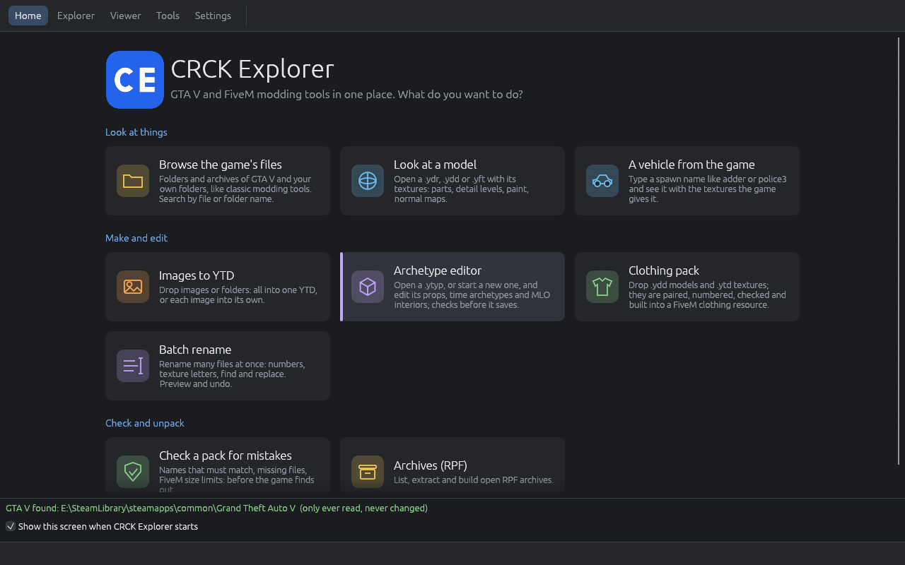
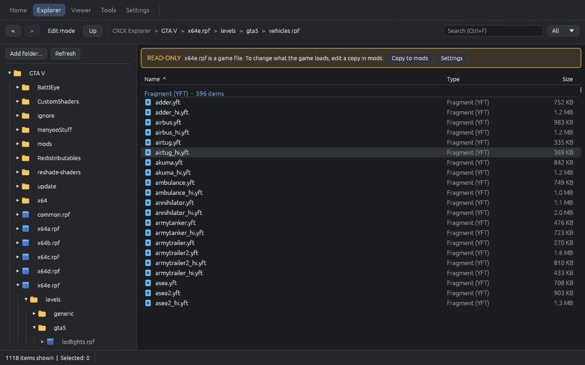
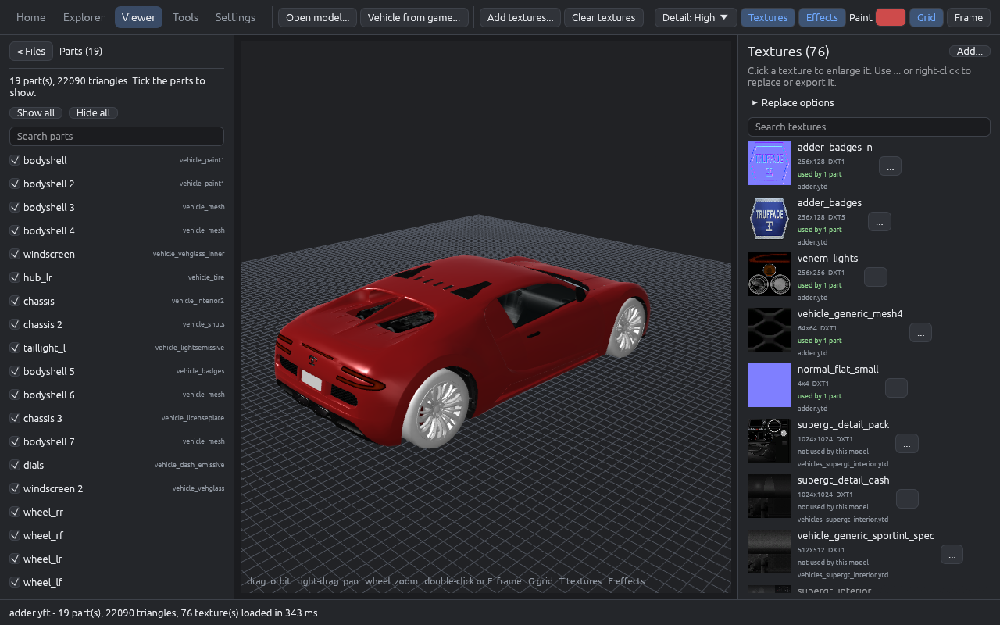
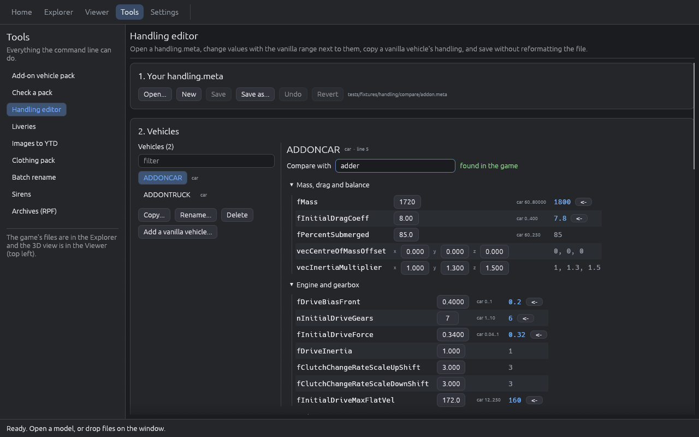
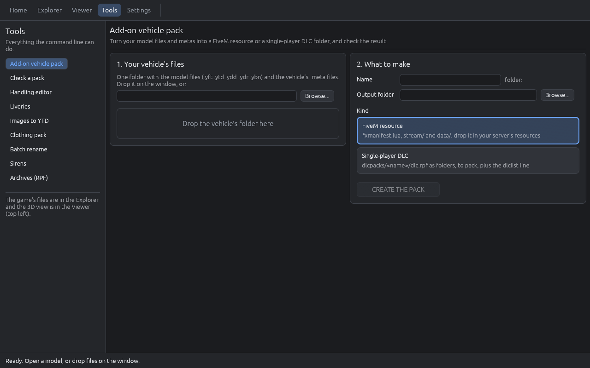
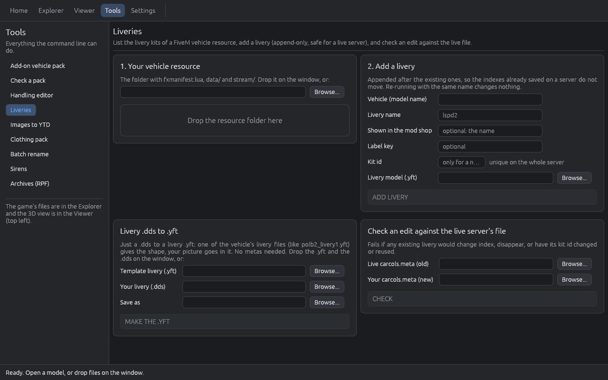

  <b>Browse the game, look at models, build add-on vehicles, edit handling and textures, and check it all before the game finds the mistakes.</b> 
  One Windows program.

  
  
  
  

## What is it?

GTA V and FiveM vehicle modding normally means a pile of separate programs: one to open the game archives, one to look at a model, one to edit textures, a text editor for the `.meta` files, and a lot of trial and error in the game to find out which name was misspelled. **CRCK Explorer puts those in one window and checks your work as you go.**

Start it and you get a screen that asks *what do you want to do?* Click a card, and you are in the right place.

## What can it do?

| | |
|---|---|
| **Browse the game** | Folders and archives of your own GTA V in a classic-style tree and list, including the encrypted retail `.rpf` files (the keys are worked out from your own `GTA5.exe`). Search for a file or a folder name across everything, like in the reference tool. Inside the game's own archives a notice offers **Copy to "mods" folder**, as classic modding tools does (it can be switched off in Settings). |
| **See a model** | Open a `.ydr`, `.ydd` or `.yft` in 3D with its textures: parts named after the skeleton's bones (`chassis`, `wheel_lf`, ...), detail levels, paint colour, normal and specular maps, glass. |
| **Get a vehicle's real textures** | Type a spawn name like `adder` and CRCK Explorer follows the game's own texture chain from `vehicles.meta` (`adder` > `vehicles_supergt_interior` > `vehshare`), so the model shows with the textures the game gives it. |
| **Build an add-on vehicle** | Turn your model files and metas into a **FiveM resource** or a single-player **DLC folder**, then check the result. |
| **Check before the game does** | Names that have to match across `vehicles`, `handling`, `carvariations`, `carcols` and `vehiclelayouts`; missing files; FiveM size limits for textures and streamed files; stray junk. Every problem says where it is and how to fix it. |
| **Edit handling** | Change a `handling.meta` with the vanilla range and a vanilla vehicle's value beside every field. Copy, rename or remove vehicles. Saving changes only the text you edited: your comments, spacing and number formats stay, and the first save keeps a `.bak`. |
| **Textures and YTD** | Drop pictures or folders of them and choose: all into one `.ytd`, or each into its own (the right format picked for each, mipmaps, power-of-two sizes, size budget). Double-click a `.ytd` in the Explorer to see every texture, then export, replace, rename, delete or add. |
| **Liveries and sirens** | Add a livery to an existing kit without shifting the ones already saved on your server; check siren settings and work out angles, patterns and speeds. |
| **Archetype editor** | Open a `.ytyp` and edit its props, time archetypes and MLO interiors with every field of the real structure, undo and redo, checks that find missing models and broken portals, an editable XML view with a live syntax check, merging of another `.ytyp` with a review of every archetype, and a save that reads the file back first so nothing is lost. |
| **Clothing packs** | Laid out like other clothing tools: your drawables on the left, the selected one in the middle, and a **3D preview** of it on the freemode body from your game. Drop `.ydd` models and `.ytd` textures (or images): they are paired by name, grouped by component, checked (missing textures, number gaps, duplicates), and built into a FiveM resource with its YMT and metas. Nothing is renumbered without asking. |
| **Batch rename** | Rename many files at once: numbers (`001`, `002`), the texture letters of clothing (`_a_`, `_c_`, `_f_` become `_a_`, `_b_`, `_c_`), drawable numbers, find and replace (with regular expressions), prefixes, case, your own patterns. You see every new name first, conflicts block it, and there is an undo. |
| **Archives (RPF)** | List, extract and build `.rpf` archives, nested ones too. In **Edit mode** (like classic modding tools) add, replace, rename and delete files inside a copy in the `mods` folder or your own archives; the game's own archives are never changed. |

Everything the window does is also a command (`crck-explorer-cli ...`), so it can be scripted.

## A look around

<b>Explorer.</b> The game's folders and archives as a tree, the contents grouped by type with sortable columns. Double-click a model to open it.

<b>Viewer.</b> The model in 3D, its parts by name, and every texture it uses.

<b>Handling editor.</b> Your value, the allowed range, and the vanilla vehicle's value with a button to take it.

<b>Add-on vehicle pack.</b> Drop the vehicle's folder, pick FiveM resource or single-player DLC, and create the pack. Every tool page works the same way: numbered cards, one big button.

<b>Liveries.</b> Read a resource's livery kits, add a livery without moving the existing ones, turn a .dds into a livery .yft, and check an edit against the live server's file.

## Made to be safe

- **Your game's own files are not changed.** Everything read from the game archives lands in a cache folder (`%LOCALAPPDATA%\CRCK Explorer\cache`). The only thing CRCK Explorer writes into the game folder is a copy you ask for in its `mods` folder (like classic modding tools), and it asks before you edit one of the game's own loose files.
- **Your files are edited in place only when you say so**, and the first save over a file keeps a `.bak` next to it.
- **Nothing from the game ships with CRCK Explorer**, and the keys for the encrypted archives come from the copy of GTA V you own.
- **Nothing leaves your PC.** There are no accounts and no network calls.

## From the command line

    crck-explorer-cli game vehicle adder out\            # the model plus the textures the game gives it
    crck-explorer-cli game search "vehshare *.ytd"       # find files or folders in every game archive
    crck-explorer-cli pack fivem myveh src\ out\         # model files + metas -> a FiveM resource
    crck-explorer-cli validate out\myveh --fivem         # cross-check the metas, the streamed files and their sizes
    crck-explorer-cli textures paint\ out\myveh.ytd      # a folder of images -> one YTD
    crck-explorer-cli handling compare my.meta --game    # your handling beside the vanilla vehicles
    crck-explorer-cli livery add pack\ --vehicle myveh --name lspd2
    crck-explorer-cli siren check carcols.meta

`crck-explorer-cli --help` lists everything; every command has its own `--help`. Double-clicking `crck-explorer-cli.exe` opens the window.

Every feature, step by step: [TUTORIAL.md](TUTORIAL.md).

## Download

Prebuilt zips are on the **Releases** page (`crck-explorer-<version>-windows-x64.zip`, with a `SHA256SUMS` file to check it against). Unzip anywhere. The zip holds:

- `crck-explorer.exe`: the window (double-click it)
- `crck-explorer-cli.exe`: the command line
- `README.md`, `TUTORIAL.md` and `LICENSE`

Windows 10 or 11, 64-bit, with a normal graphics driver (DirectX 12 or Vulkan). The exes are not code-signed, so SmartScreen may warn on the first start: **More info > Run anyway**.

**Your GTA V folder** is found by itself (Steam, Rockstar and Epic locations on every drive). Point CRCK Explorer at another place once with `crck-explorer-cli game --dir "D:\Games\Grand Theft Auto V" info` (it remembers the folder). Without the game, the Viewer and all the Tools still work on your own files.

## Build it yourself

Install Rust (stable, MSVC toolchain) and the Visual Studio Build Tools with the *Desktop development with C++* workload. **Build from PowerShell**, not Git Bash: Git Bash's own `link.exe` comes first on the path and breaks linking.

    cargo build --release -p crck-explorer-cli -p rage-toolkit-app    # target\release\crck-explorer-cli.exe and crck-explorer.exe
    cargo test --workspace                                # tests that need real game files skip themselves

For self-contained exes like the releases, set `$env:RUSTFLAGS = "-C target-feature=+crt-static"` first.

## Licence

CRCK Explorer is free software under the [GNU General Public License v3.0](LICENSE) (or any later version): you may use, share and change it, and anything you share that is built from it must be under the same licence, with its source.

## AI disclaimer

AI tools were used to help build this project, including parts of the code, the tests and the documentation. It is provided as is: test it on copies of your files before you rely on it.
